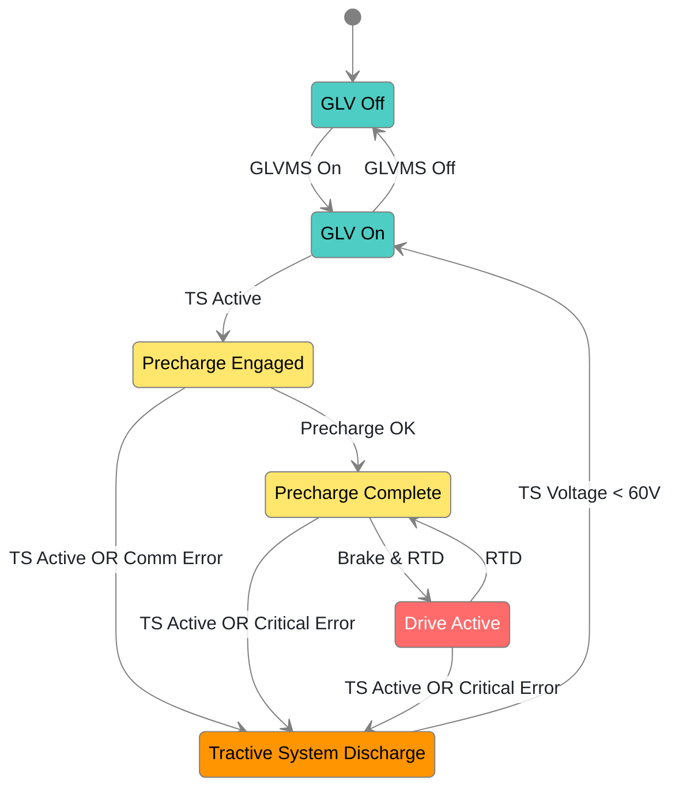

# GR Firmware

[](https://github.com/Gaucho-Racing/Firmware/actions/workflows/AutoFormat.yml)
[](https://github.com/Gaucho-Racing/Firmware/actions/workflows/Linter.yml)
[](https://github.com/Gaucho-Racing/Firmware/actions/workflows/UnitTestsHOOTL.yml)

For more, please see [`CONTRIBUTING.md`](CONTRIBUTING.md) and the various other Markdown files scattered throughout the monorepo.

## State Machine

This diagram governs the state of the car and represents the logical overview of processes on the car. This diagram must reflect the actual car operations and will help to confirm rules compliance.

If changes are made to the state machine, either in diagram or in implementation, then that PR with the change must update both representations.

The state machine runs on the ECU, but it maps to an enum which is transmitted over CAN. Again, changes to implementation must be reflected in the diagram and vice-versa.



- 🟦 **Blue**: Low voltage
- 🟥 **Red**: HV charged
- 🟨 **Yellow**: HV precharge
- 🟧 **Orange**: HV discharge

## Setup

### Git and GitHub

Install [`Git`](https://git-scm.com/install/) on your specific platform, prefer using your platforms package manager (WinGet, Apt, Homebrew, DNF, Pacman, Pkg, ... etc) over other methods.

Authenticate your Sentinel profile with GitHub through [`sso.gauchoracing.com/settings/connected-accounts`](https://sso.gauchoracing.com/settings/connected-accounts)

There are numerous ways to authenticate your Git client with your GitHub credentials, one common option is to install the [`GitHub CLI`](https://cli.github.com/) and then running `gh auth login`. You can also use [SSH Keys](https://docs.github.com/en/authentication/connecting-to-github-with-ssh) or other options.

Clone the repository by running `gh repo clone Gaucho-Racing/Firmware` or `git clone http://github.com/Gaucho-Racing/Firmware.git` or `git clone git@github.com:Gaucho-Racing/Firmware.git` depending on your chosen authentification strategy.

### Tooling

Download [VS Code](https://code.visualstudio.com/download) and install it on your system, you can use other editors or IDEs but under your own support.

Verify the following commands work without errors, if they fail please see the instructions below for your OS

- `cmake --version`
- `ninja --version`
- `arm-none-eabi-gcc --version`
- `openocd --version`

**CMake** (metabuild system) --> **Ninja** (build system) --> **Arm Toolchain** (provides tools to compile & link code)

**OpenOCD** is an on-chip debugger, which allows us to examine code line-by-line in Debug mode through our debugger **GDB**

#### Windows

1. `winget install Ninja-build.Ninja Kitware.CMake Arm.GnuArmEmbeddedToolchain Microsoft.VisualStudioCode`
2. [OpenOCD](https://github.com/openocd-org/openocd/releases/latest) -> Download the `.tar.gz` file, extract to directory, add the bin directory to your `PATH`
3. Relaunch your terminal

#### MacOS

1. `/bin/bash -c "$(curl -fsSL https://raw.githubusercontent.com/Homebrew/install/HEAD/install.sh)"`
2. `brew install cmake ninja open-ocd gcc-arm-embedded visual-studio-code`
3. Relaunch your terminal

#### Unix-Derived

Choose the below command given your specific flavor of Linux or BSD

* `sudo apt install cmake ninja gcc-arm-none-eabi openocd`
* `sudo dnf install cmake ninja openocd` (Normally also `arm-none-eabi-gcc-cs arm-none-eabi-newlib` which worked on Fedora 42 but is broken on Fedora 43, use [Arm's version](https://developer.arm.com/downloads/-/arm-gnu-toolchain-downloads) instead for the moment)
* `sudo pacman -S cmake ninja openocd arm-none-eabi-gcc`
* `sudo pkg install cmake ninja openocd arm-none-eabi-gcc`

If you run into issues verify that binutils and newlib are installed for `arm-none-eabi`

### Compilation and Flashing

Note that you can also flash your executable binary files using [`STM32CubeProgrammer`](https://www.st.com/content/st_com/en/stm32cubeprogrammer.html), you still have to compile your program using one of the below methods though.

#### Command Line

You can compile using `make <Preset>` (such as `make Debug`) which will invoke CMake, or you can compile directly from CMake using `cmake --preset <Preset> ; cmake --build --preset <Preset>`.

The following presets are currently configured in [`CMakePresets.json`](CMakePresets.json)

- `Debug`
- `Release`
- `MinSizeRel`
- `RelWithDebInfo`
- `HOOTLTest` (see [testing](#testing))

To compile specifically for one target you can use the below command

```sh
cmake --preset <Preset>
cmake --build --preset <Preset> --target <Target>
```

After building, you will need to flash using OpenOCD, there are a variety of options for this, but the easiest will be to `openocd -f interface/<interface>.cfg -f target/{series}.cfg -c "program {file}.elf <commands>"`. Often this will look like the following

```sh
openocd -f interface/stlink.cfg -f target/{Series}.cfg -c "program build/<Preset>/{Target}.elf verify reset exit"
```

You can get more advanced and connect to your board using OpenOCD and then launch a debugging session using GDB, this is more complicated and we recommend using VS Code instead, but it is fun to do via the commandline.

#### Visual Studio Code

Install the recommended extensions in [`.vscode/extensions.json`](.vscode/extensions.json), if you are using the extension tab (the icon looks like 3 squares with one square at a 45 degree angle) you can also search by `@recommended` and it will show what extensions you need.

Make sure that you select a configuration preset, you can type in the search bar `>CMake: Select Configure Preset`, or navigate to the CMake tab (the icon is the CMake triangle icon with a wrench) and ensure that "Configure" is set to one of `Debug`, `Release`, `MinSizeRel`, or `RelWithDebInfo`. More on the `HOOTLTest` option in [testing](#testing).

On the run and debug tab (the icon looks like a triangle with a bug on it) select the drop down to choose the project you wish to run, and then click the green play triangle next to the drop down. If [`.vscode/launch.json`](.vscode/launch.json) is configured to open a Serial Wire Output (SWO) terminal it will open automatically for you.

At the top of the window you should see a series of options, you can use the different buttons to pause/resume, step into, step out of, step over, and stop debugging a program. You will see the run and debug window also populate with debugging information, and even more when the program is paused.

## Frequently Asked Questions

### MacOS Issues

See the [wiki](https://wiki.gauchoracing.com/books/architecture/page/cmake-notes-for-monorepo) which may be possibly outdated, eventually it should be ported into this

You may also have connection issues with LibUSB, try connecting through a dongle instead of directly to your board.

### Rebase vs Merge

Rebase when possible for linear histories, please run `git config pull.rebase true` to set that as the default when you run `git pull`.

### Comments

When able, please add VS Code comptatible doc comments! These will help debugging and appear on the tool tip (hover) of any known function.

Eventually, we may autogenerate documentation for the different programs and this will be key... maybe

### GitHub Action Emails

If you do not want GitHub Action emails please turn off notifications on your side. See something like [stackoverflow.com/q/66116203](https://stackoverflow.com/q/66116203)

## Legal

**_DO NOT DELETE ANY LICENSE INFORMATION ON ANY COPIED FILE OR LINE OF CODE_**

See [`LICENSE.md`](LICENSE.md) for more.
